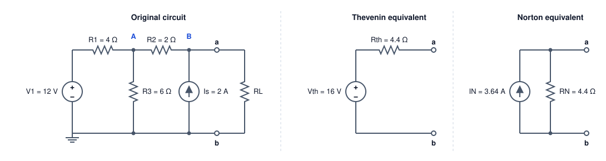

# Network Theorems

Superposition, source transformation, Thevenin, Norton and maximum power transfer, each checked against a full nodal solution of one example circuit.

Author

Benedict Thekkel

[Electricity Equations](electricity_equations.llms.md) ends at Ohm’s law and Kirchhoff’s laws. Those two laws can solve any linear circuit, but they make you solve the whole circuit every time. The theorems on this page are shortcuts. They let you replace most of a circuit with something much smaller, and then ask questions about the part you care about.

Every theorem here is checked in code against a full nodal solution of the same circuit. If a shortcut and the full solution disagree, the assertions at the end of each section fail.

## Linearity is the whole idea

A circuit built from resistors, independent sources and linear dependent sources is **linear**. Every node voltage and every branch current is a weighted sum of the source values. Double every source and every current doubles. Two consequences follow, and every theorem on this page is one of them.

1.  **Superposition.** Because the response is a sum, you can find each source’s share separately and add the shares.
2.  **Equivalence.** Seen from two terminals, a linear network has a straight-line voltage-current characteristic. A straight line needs only two numbers to describe it. So any such network, however large, can be replaced by two elements: a source and a resistance. Thevenin and Norton are the two ways to write that line.

The theorems break as soon as something is not linear. A diode, a saturating transformer core or a transistor at its limits all have curved characteristics. The [last section](#when-the-shortcuts-fail) covers what to do then.

------------------------------------------------------------------------

## The example circuit

One circuit runs through the whole page. It has a voltage source, a current source and three resistors. A load resistor $R_L$ connects across terminals a and b. The question is always the same: what current flows in $R_L$, for any value of $R_L$?



Example circuit: V1 = 12 V in series with R1 = 4 ohm feeds node A; R3 = 6 ohm runs from A to ground; R2 = 2 ohm joins A to node B; current source Is = 2 A injects into B; load RL sits across terminals a and b. Its Thevenin equivalent is 16 V in series with 4.4 ohm, and its Norton equivalent is 3.64 A in parallel with 4.4 ohm.

The right-hand panels are the answer this page works towards. Seen from terminals a and b, the whole left-hand circuit behaves exactly like a 16 V source behind 4.4 $\Omega$.

------------------------------------------------------------------------

## Nodal analysis: the reference answer

Nodal analysis writes Kirchhoff’s current law at every node whose voltage is unknown. Ground is the reference, so the unknowns are $V_A$ and $V_B$. Current leaving each node through each branch sums to zero:

$$\begin{bmatrix}
\frac{1}{R_1}+\frac{1}{R_2}+\frac{1}{R_3} & -\frac{1}{R_2} \\
-\frac{1}{R_2} & \frac{1}{R_2}+\frac{1}{R_L}
\end{bmatrix}
\begin{bmatrix} V_A \\ V_B \end{bmatrix}
=
\begin{bmatrix} V_1 / R_1 \\ I_s \end{bmatrix}$$

The matrix is the **conductance matrix** $G$. Its diagonal holds the total conductance at each node, and each off-diagonal term is minus the conductance joining two nodes. The right-hand side holds the source currents pushed into each node. Solving $G\,v = i$ is one call to `np.linalg.solve`. Circuit simulators such as SPICE build the same matrix, only larger.

``` python
import numpy as np
from pyecharts import options as opts
from pyecharts.charts import Line, Bar
from pyecharts.globals import CurrentConfig

# assets.pyecharts.org served an expired TLS cert on 2026-11-11; pin the jsDelivr mirror
CurrentConfig.ONLINE_HOST = "https://cdn.jsdelivr.net/gh/pyecharts/pyecharts-assets@f2328d558550046fc5449672a6850e848e141590/assets/v6/"

R1, R2, R3 = 4.0, 2.0, 6.0   # ohm
V1, Is = 12.0, 2.0           # V, A

def solve(V1=V1, Is=Is, RL=np.inf):
    "Node voltages (VA, VB) by nodal analysis. RL=inf leaves terminals a-b open."
    gL = 0.0 if np.isinf(RL) else 1 / RL
    G = np.array([[1/R1 + 1/R2 + 1/R3, -1/R2],
                  [-1/R2,               1/R2 + gL]])
    i = np.array([V1 / R1, Is])
    return np.linalg.solve(G, i)

RL = 10.0
VA, VB = solve(RL=RL)
I_L = VB / RL
print(f"VA = {VA:.4f} V   VB = {VB:.4f} V   I_L = {I_L:.4f} A")
```

    VA = 9.3333 V   VB = 11.1111 V   I_L = 1.1111 A

With a 10 $\Omega$ load, $V_B = 11.11$ V and the load carries 1.111 A. Every method below must reproduce that number.

------------------------------------------------------------------------

## Superposition

Turn off every source except one, solve, and repeat for each source. The real response is the sum of the partial responses.

“Turn off” has a precise meaning. A voltage source switched off is a 0 V source, which is a **short circuit**. A current source switched off is a 0 A source, which is an **open circuit**. Getting these backwards is the most common mistake with this theorem.

``` python
VB_v1 = solve(V1=V1, Is=0.0, RL=RL)[1]   # Is open
VB_is = solve(V1=0.0, Is=Is, RL=RL)[1]   # V1 shorted
print(f"V1 alone: {VB_v1:.4f} V   Is alone: {VB_is:.4f} V")
print(f"sum:      {VB_v1 + VB_is:.4f} V   full solution: {VB:.4f} V")

P_full = VB**2 / RL
P_parts = VB_v1**2 / RL + VB_is**2 / RL
print(f"load power: full {P_full:.3f} W, sum of partial powers {P_parts:.3f} W")
```

    V1 alone: 5.0000 V   Is alone: 6.1111 V
    sum:      11.1111 V   full solution: 11.1111 V
    load power: full 12.346 W, sum of partial powers 6.235 W

The voltages add up exactly: 5 V from $V_1$ plus 6.11 V from $I_s$ gives 11.11 V. The powers do not. Power goes as voltage squared, and $(a+b)^2 \neq a^2 + b^2$. **Superposition works for voltages and currents, never for power.** Find the total voltage or current first, then compute power from it.

------------------------------------------------------------------------

## Source transformation

A voltage source $V$ in series with a resistor $R$ and a current source $V/R$ in parallel with the same $R$ look identical from their terminals. Both give $V$ when open-circuited and $V/R$ when short-circuited. Since a linear two-terminal network is fully described by those two points, the two are interchangeable.

Swapping one form for the other lets you collapse a ladder circuit by hand. Series resistors add in the voltage-source form, and parallel current sources add in the current-source form. The cell below folds the example circuit down to a single source, one step at a time.

``` python
def par(a, b):
    return a * b / (a + b)

steps = []
I = V1 / R1                      # 1. V1 + R1 in series  ->  3 A parallel with R1
R = R1
steps.append(("V1, R1 as a current source", I, "A", R))
R = par(R, R3)                   # 2. R3 is now in parallel: combine
steps.append(("absorb R3 in parallel", I, "A", R))
V = I * R; I = None              # 3. back to a voltage source
steps.append(("convert to a voltage source", V, "V", R))
R = R + R2                       # 4. R2 is in series: add
steps.append(("absorb R2 in series", V, "V", R))
I = V / R                        # 5. to a current source, then add Is in parallel
I = I + Is
steps.append(("convert, then add Is in parallel", I, "A", R))

for name, val, unit, r in steps:
    print(f"{name:34s} {val:7.4f} {unit}   with {r:.4f} ohm")
```

    V1, R1 as a current source          3.0000 A   with 4.0000 ohm
    absorb R3 in parallel               3.0000 A   with 2.4000 ohm
    convert to a voltage source         7.2000 V   with 2.4000 ohm
    absorb R2 in series                 7.2000 V   with 4.4000 ohm
    convert, then add Is in parallel    3.6364 A   with 4.4000 ohm

Five steps reduce the circuit to a 3.636 A source in parallel with 4.4 $\Omega$. That is the Norton equivalent in the diagram, found without writing a single equation.

------------------------------------------------------------------------

## Thevenin equivalent

**Thevenin’s theorem:** any linear two-terminal network can be replaced by a voltage source $V_{th}$ in series with a resistance $R_{th}$.

- $V_{th}$ is the **open-circuit voltage** across the terminals, with no load connected.
- $R_{th}$ is the resistance seen looking into the terminals with every independent source switched off.

There is a second way to find $R_{th}$: short the terminals, measure the short-circuit current $I_{sc}$, and take $R_{th} = V_{oc} / I_{sc}$. This version also works on a real box you cannot open, and on circuits with dependent sources, which cannot be switched off.

``` python
V_th = solve(RL=np.inf)[1]                  # open circuit

R_th_off = R2 + par(R1, R3)                 # sources off: V1 shorted, Is open

VA_sc = (V1 / R1) / (1/R1 + 1/R2 + 1/R3)    # terminals shorted: VB = 0
I_sc = VA_sc / R2 + Is
R_th_meas = V_th / I_sc

print(f"V_th = {V_th:.4f} V")
print(f"R_th = {R_th_off:.4f} ohm (sources off)   {R_th_meas:.4f} ohm (Voc / Isc)")
print(f"I_sc = {I_sc:.4f} A")

loads = np.logspace(-1, 3, 200)
I_nodal = np.array([solve(RL=r)[1] / r for r in loads])
I_thev = V_th / (R_th_off + loads)
print(f"worst disagreement over 0.1 to 1000 ohm loads: {np.abs(I_nodal - I_thev).max():.2e} A")
```

    V_th = 16.0000 V
    R_th = 4.4000 ohm (sources off)   4.4000 ohm (Voc / Isc)
    I_sc = 3.6364 A
    worst disagreement over 0.1 to 1000 ohm loads: 8.88e-16 A

Both routes give $R_{th} = 4.4\ \Omega$. Across 200 load values from 0.1 $\Omega$ to 1 k$\Omega$, the two-element model matches the full nodal solution to within rounding error. The left-hand circuit and its Thevenin equivalent cannot be told apart from terminals a and b.

------------------------------------------------------------------------

## Norton equivalent

**Norton’s theorem** writes the same straight line the other way: a current source $I_N = I_{sc}$ in parallel with $R_N = R_{th}$. Source transformation turns one into the other, so the two theorems are really one result.

Which form to use depends on the load. Thevenin suits a load in series, because the resistances simply add. Norton suits loads in parallel, because conductances add and the current divides. With Norton, the load current is a **current divider**:

$$I_L = I_N \frac{R_N}{R_N + R_L}$$

``` python
I_N, R_N = I_sc, R_th_off
I_norton = I_N * R_N / (R_N + RL)
print(f"I_N = {I_N:.4f} A, R_N = {R_N:.4f} ohm -> I_L = {I_norton:.4f} A (nodal: {I_L:.4f} A)")
```

    I_N = 3.6364 A, R_N = 4.4000 ohm -> I_L = 1.1111 A (nodal: 1.1111 A)

------------------------------------------------------------------------

## Maximum power transfer

With the circuit reduced to $V_{th}$ and $R_{th}$, the power delivered to the load is a one-line function of $R_L$:

$$P_L = \frac{V_{th}^2 R_L}{(R_{th}+R_L)^2}$$

Setting $dP_L/dR_L = 0$ gives $R_L = R_{th}$, and then $P_{max} = V_{th}^2 / 4R_{th}$. This is the **maximum power transfer theorem**.

The catch shows up in the efficiency. At the matched point, the same current flows through $R_{th}$ and $R_L$, and the two are equal, so exactly half the power is burnt inside the source. The chart shows both curves.

``` python
rl = np.round(np.arange(0.2, 40.01, 0.2), 1)
p = V_th**2 * rl / (R_th_off + rl)**2
eff = 100 * rl / (R_th_off + rl)

chart = (
    Line(init_opts=opts.InitOpts(width="100%", height="380px"))
    .add_xaxis([f"{x:.1f}" for x in rl])
    .add_yaxis("load power (W)", [round(float(v), 3) for v in p], is_symbol_show=False,
               markline_opts=opts.MarkLineOpts(data=[opts.MarkLineItem(x="4.4", name="RL = Rth")],
                                               label_opts=opts.LabelOpts(formatter="RL = Rth")))
    .add_yaxis("efficiency (%)", [round(float(v), 2) for v in eff], yaxis_index=1, is_symbol_show=False)
    .extend_axis(yaxis=opts.AxisOpts(name="efficiency (%)", min_=0, max_=100))
    .set_series_opts(label_opts=opts.LabelOpts(is_show=False))
    .set_global_opts(
        title_opts=opts.TitleOpts(title="Load power and efficiency against load resistance"),
        xaxis_opts=opts.AxisOpts(name="RL (ohm)", boundary_gap=False),
        yaxis_opts=opts.AxisOpts(name="power (W)"),
        tooltip_opts=opts.TooltipOpts(trigger="axis"),
        legend_opts=opts.LegendOpts(pos_top="8%"),
    )
)
print(f"peak at RL = {rl[p.argmax()]:.1f} ohm, P_max = {p.max():.3f} W, efficiency there = {eff[p.argmax()]:.0f} %")
chart.render_notebook()
```

    peak at RL = 4.4 ohm, P_max = 14.545 W, efficiency there = 50 %

The power peaks at 14.5 W when $R_L = 4.4\ \Omega$, at exactly 50 % efficiency. Past the peak, load power falls but efficiency keeps climbing towards 100 %.

That one chart explains why two fields treat this theorem so differently:

| Field | Goal | Design choice |
|----|----|----|
| Radio, antennas, audio, sensors | Get the most **signal** out of a weak source | Match the load to the source ($R_L = R_{th}$; 50 $\Omega$ RF systems) |
| Power systems, batteries, chargers | Waste as little **energy** as possible | Keep $R_L \gg R_{th}$; the grid’s source impedance is tiny next to any load |

A power station run at maximum power transfer would burn half its output in its own windings and lines.

------------------------------------------------------------------------

## When the shortcuts fail

- **Nonlinear parts.** A diode or a solar cell has a curved characteristic, so no single Thevenin pair describes it. Engineers linearise around an operating point instead. The resulting **small-signal** equivalent is valid only for small changes about that point.
- **Power.** As the superposition section showed, partial powers never add. Superpose voltages or currents, then compute power.
- **Dependent sources.** A source controlled by another voltage or current cannot be switched off. Find $R_{th}$ from $V_{oc}/I_{sc}$, or drive the terminals with a test source and measure the ratio.
- **AC circuits.** All of these theorems carry over to sinusoidal steady state if you replace resistances with complex impedances at one frequency. $Z_{th}$ is then complex, and maximum power transfer becomes a **conjugate match**, $Z_L = Z_{th}^*$, which also cancels the reactance. [Three-Phase Power Systems](three_phase_power_systems.llms.md) uses the same phasor tools.

------------------------------------------------------------------------

## Summary

| Theorem | What it gives you | Reach for it when |
|----|----|----|
| Nodal analysis | Every node voltage, by solving $Gv = i$ | You need the whole circuit, or a computer will do the work |
| Superposition | Each source’s share of a voltage or current | Sources of different kinds or frequencies act at once |
| Source transformation | Swap series $V$-$R$ for parallel $I$-$R$ | Collapsing a ladder circuit by hand |
| Thevenin | $V_{th}$ in series with $R_{th}$ | The load varies, or sits in series |
| Norton | $I_N$ in parallel with $R_N$ | Loads in parallel, or current-source models such as transistors |
| Maximum power transfer | $R_L = R_{th}$ for most power, at 50 % efficiency | Signal and RF work, never power delivery |

------------------------------------------------------------------------

Back to top
