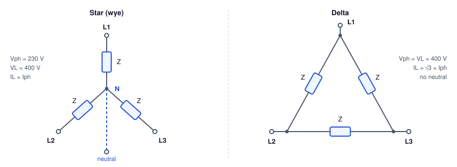

# Three-Phase Power Systems

Phasors, star and delta, three-phase power, power factor correction, why transmission runs at high voltage, and how the grid keeps supply equal to demand, worked for a 230/400 V, 50 Hz system.

Author

Benedict Thekkel

Almost all electricity is generated, transmitted and used as **three-phase alternating current**. In Australia, a house gets one phase at 230 V. A workshop or a factory gets all three at 400 V between lines. The grid runs at 50 Hz (60 Hz in the Americas). This page builds up the tools in order: phasors, then three phases, then power and power factor, then transmission, and last, how a grid keeps supply equal to demand every second.

Each section computes a worked example and checks it with assertions. The numbers use the Australian low-voltage standard of 230/400 V, 50 Hz.

## Phasors

A steady sine wave $v(t) = V_m \cos(\omega t + \phi)$ is fully described by two numbers: its size and its phase angle. Frequency is the same everywhere in the circuit, so it can be left out. A **phasor** packs the two numbers into one complex number, $V = V_{rms}\angle\phi$. Engineers use the RMS (root mean square) value, $V_{rms} = V_m/\sqrt{2}$, because it gives the same heating as DC of that size. “230 V” means 230 V RMS, which peaks at 325 V.

Inductors and capacitors then become complex **impedances**: $Z_L = j\omega L$ and $Z_C = 1/(j\omega C)$. With $Z = R + jX$, Ohm’s law works unchanged, $I = V/Z$. Python’s built-in complex type does the arithmetic. Python writes $j$ as `1j`.

``` python
import numpy as np
from pyecharts import options as opts
from pyecharts.charts import Line, Bar
from pyecharts.globals import CurrentConfig

# assets.pyecharts.org served an expired TLS cert on 2026-11-11; pin the jsDelivr mirror
CurrentConfig.ONLINE_HOST = "https://cdn.jsdelivr.net/gh/pyecharts/pyecharts-assets@f2328d558550046fc5449672a6850e848e141590/assets/v6/"
import cmath
from scipy.integrate import solve_ivp

f0 = 50.0                 # Hz
w = 2 * np.pi * f0        # rad/s
V_ph = 230.0              # V rms, line to neutral

def polar(z, unit=""):
    "Format a complex number as magnitude and angle in degrees."
    return f"{abs(z):.2f}{unit} at {np.degrees(cmath.phase(z)):+.2f} deg"

Z = 8 + 6j                # ohm: 8 ohm resistance, 6 ohm inductive reactance
L = 6 / w                 # the inductance that gives X = 6 ohm at 50 Hz
I = V_ph / Z
pf = np.cos(cmath.phase(Z))
print(f"Z = {polar(Z, ' ohm')}   (L = {L * 1e3:.2f} mH)")
print(f"I = {polar(I, ' A')}")
print(f"power factor = {pf:.2f} lagging; P = {V_ph * abs(I) * pf:.0f} W")
```

    Z = 10.00 ohm at +36.87 deg   (L = 19.10 mH)
    I = 23.00 A at -36.87 deg
    power factor = 0.80 lagging; P = 4232 W

The current is 23 A and lags the voltage by 36.9 degrees, because the inductor resists changes in current. The cosine of that angle, 0.8, is the **power factor**. Only the part of the current in phase with the voltage delivers energy.

------------------------------------------------------------------------

## Three phases

A three-phase generator has three windings spaced 120 degrees apart around its rotor, so it produces three sine waves 120 degrees apart in time. Two properties make this the standard everywhere.

1.  **The three currents sum to zero** when the loads are balanced, so a single neutral wire carries almost nothing. Three circuits need three or four wires instead of six.
2.  **Total power is constant**, not pulsing. A single-phase load draws power in pulses at twice the line frequency. Three phases add up to a flat line. That is why three-phase motors run smoothly and are self-starting.

``` python
t = np.linspace(0, 0.04, 161)             # two cycles at 50 Hz, 0.25 ms steps
Vm = np.sqrt(2) * V_ph
phi = cmath.phase(Z)
shifts = [0, -2 * np.pi / 3, 2 * np.pi / 3]
v = [Vm * np.cos(w * t + s) for s in shifts]
i = [Vm / abs(Z) * np.cos(w * t + s - phi) for s in shifts]
p = [vk * ik for vk, ik in zip(v, i)]
v_sum, p_total = sum(v), sum(p)

ms = [f"{x * 1e3:.2f}" for x in t]
volts = (
    Line(init_opts=opts.InitOpts(width="100%", height="340px"))
    .add_xaxis(ms)
    .add_yaxis("L1", [round(float(x), 1) for x in v[0]], is_symbol_show=False)
    .add_yaxis("L2", [round(float(x), 1) for x in v[1]], is_symbol_show=False)
    .add_yaxis("L3", [round(float(x), 1) for x in v[2]], is_symbol_show=False)
    .add_yaxis("sum", [round(float(x), 6) for x in v_sum], is_symbol_show=False,
               linestyle_opts=opts.LineStyleOpts(width=3, type_="dashed"))
    .set_series_opts(label_opts=opts.LabelOpts(is_show=False))
    .set_global_opts(
        title_opts=opts.TitleOpts(title="Three phase voltages and their sum"),
        xaxis_opts=opts.AxisOpts(name="ms", boundary_gap=False),
        yaxis_opts=opts.AxisOpts(name="V"),
        tooltip_opts=opts.TooltipOpts(trigger="axis"),
        legend_opts=opts.LegendOpts(pos_top="8%"),
    )
)
print(f"largest |vA + vB + vC| over two cycles: {np.abs(v_sum).max():.2e} V")
volts.render_notebook()
```

    largest |vA + vB + vC| over two cycles: 4.26e-13 V

``` python
power = (
    Line(init_opts=opts.InitOpts(width="100%", height="340px"))
    .add_xaxis(ms)
    .add_yaxis("L1 power", [round(float(x), 1) for x in p[0]], is_symbol_show=False)
    .add_yaxis("L2 power", [round(float(x), 1) for x in p[1]], is_symbol_show=False)
    .add_yaxis("L3 power", [round(float(x), 1) for x in p[2]], is_symbol_show=False)
    .add_yaxis("total", [round(float(x), 1) for x in p_total], is_symbol_show=False,
               linestyle_opts=opts.LineStyleOpts(width=3))
    .set_series_opts(label_opts=opts.LabelOpts(is_show=False))
    .set_global_opts(
        title_opts=opts.TitleOpts(title="Instantaneous power: each phase pulses, the total does not"),
        xaxis_opts=opts.AxisOpts(name="ms", boundary_gap=False),
        yaxis_opts=opts.AxisOpts(name="W"),
        tooltip_opts=opts.TooltipOpts(trigger="axis"),
        legend_opts=opts.LegendOpts(pos_top="8%"),
    )
)
print(f"total power: min {p_total.min():.1f} W, max {p_total.max():.1f} W; 3 x V x I x pf = {3 * V_ph * abs(I) * pf:.1f} W")
power.render_notebook()
```

    total power: min 12696.0 W, max 12696.0 W; 3 x V x I x pf = 12696.0 W

Each phase’s power swings between a small negative value and twice its average, 100 times a second. The negative part is energy the inductance hands back each cycle. The total is a flat 12.7 kW.

------------------------------------------------------------------------

## Star and delta

There are two ways to connect three loads, or three windings, to three lines.



Star connection: three impedances Z meet at a neutral point N, with lines L1, L2 and L3 at their outer ends; phase voltage 230 V, line voltage 400 V, line current equals phase current. Delta connection: three impedances form a triangle between the lines; phase voltage equals line voltage of 400 V, line current is root 3 times phase current, and there is no neutral.

- **Star (wye, Y).** Each load sits between a line and the neutral, so it sees the **phase voltage**, 230 V. The voltage between two lines is the difference of two phasors 120 degrees apart. That difference is $\sqrt{3}$ times larger and leads by 30 degrees: $V_L = \sqrt{3}\,V_{ph} = 400$ V.
- **Delta (**$\Delta$). Each load sits between two lines, so it sees the full **line voltage**, 400 V. Each line current is now the difference of two load currents: $I_L = \sqrt{3}\,I_{ph}$.

The cell below checks the $\sqrt{3}$ and the 30 degrees with phasor arithmetic. It also checks the star-delta equivalence for balanced loads: a delta of $Z$ draws the same line current as a star of $Z/3$.

``` python
a = cmath.rect(1, 2 * np.pi / 3)          # the 120 degree rotation operator
Va, Vb, Vc = V_ph, V_ph * a**2, V_ph * a   # positive sequence: A, then B 120 deg later
Vab = Va - Vb
print(f"Va  = {polar(Va, ' V')}")
print(f"Vab = {polar(Vab, ' V')}   ratio |Vab|/|Va| = {abs(Vab) / abs(Va):.4f} = sqrt(3)")

Zd = 3 * Z                                 # a delta of 3Z ...
I_ab, I_ca = Vab / Zd, (Vc - Va) / Zd
I_line_delta = I_ab - I_ca
I_line_star = Va / Z                       # ... matches a star of Z
print(f"delta of 3Z: line current {polar(I_line_delta, ' A')}")
print(f"star of Z:   line current {polar(I_line_star, ' A')}")
```

    Va  = 230.00 V at +0.00 deg
    Vab = 398.37 V at +30.00 deg   ratio |Vab|/|Va| = 1.7321 = sqrt(3)
    delta of 3Z: line current 23.00 A at -36.87 deg
    star of Z:   line current 23.00 A at -36.87 deg

The same factor is behind **star-delta starting** of large motors. Started in star, each winding sees $1/\sqrt{3}$ of its rated voltage, so it draws one third of the current and makes one third of the torque. Once the motor is up to speed, a contactor switches the windings to delta.

------------------------------------------------------------------------

## Three-phase power and the power triangle

For a balanced load, the power in each phase is the same, so the total is three times one phase. Written with line quantities, which are what you can measure on the cables:

$$P = \sqrt{3}\,V_L I_L \cos\phi \qquad Q = \sqrt{3}\,V_L I_L \sin\phi \qquad S = \sqrt{3}\,V_L I_L$$

- $P$ is **real power**, in watts. It does work and turns the meter.
- $Q$ is **reactive power**, in volt-amperes reactive (var). It is energy that sloshes back and forth into magnetic fields each cycle. It does no net work, but it still flows in the cables.
- $S$ is **apparent power**, in volt-amperes (VA). It sets the current, and therefore the size of every cable, fuse and transformer.

The three form a right triangle, $S^2 = P^2 + Q^2$, and the power factor is $P/S$. As a complex number, $S = P + jQ = 3\,V_{ph} I_{ph}^*$, where $^*$ is the complex conjugate.

The example is a workshop motor load of 30 kW at a power factor of 0.8 lagging, on 400 V.

``` python
V_L = np.sqrt(3) * V_ph          # 398 V; the nominal 400 V is a rounded value
P = 30e3                          # W
pf0 = 0.8
S0 = P / pf0
Q0 = np.sqrt(S0**2 - P**2)
I0 = S0 / (np.sqrt(3) * V_L)
print(f"S = {S0 / 1e3:.1f} kVA   P = {P / 1e3:.1f} kW   Q = {Q0 / 1e3:.1f} kvar   line current = {I0:.1f} A")
```

    S = 37.5 kVA   P = 30.0 kW   Q = 22.5 kvar   line current = 54.3 A

The motor does 30 kW of work, but the cables carry current for 37.5 kVA. The 22.5 kvar of reactive power is the magnetising current the motor needs to make its field.

------------------------------------------------------------------------

## Power factor correction

Reactive current costs money even though it does no work. It needs bigger cables and transformers, it heats them ($I^2R$ losses), and many network tariffs charge on kVA demand or penalise a low power factor. A capacitor draws reactive current of the opposite sign, so a capacitor bank across the motor supplies its magnetising current locally. The network then supplies only the real power.

To raise the power factor from $\cos\phi_1$ to $\cos\phi_2$, the capacitors must supply:

$$Q_C = P(\tan\phi_1 - \tan\phi_2)$$

The capacitance depends on how the bank is connected. In delta, each capacitor sees the line voltage, so $C = Q_C / (3\,\omega V_L^2)$. In star, each sees the phase voltage, which is three times smaller squared, so star needs three times the capacitance for the same kvar.

``` python
def kvar_needed(P, pf_from, pf_to):
    return P * (np.tan(np.arccos(pf_from)) - np.tan(np.arccos(pf_to)))

pf1 = 0.95
Qc = kvar_needed(P, pf0, pf1)
C_delta = Qc / (3 * w * V_L**2)
C_star = Qc / (3 * w * V_ph**2)
I1 = P / (np.sqrt(3) * V_L * pf1)
pf_check = P / np.hypot(P, Q0 - Qc)

print(f"capacitor bank: {Qc / 1e3:.2f} kvar -> {C_delta * 1e6:.1f} uF per phase in delta, {C_star * 1e6:.1f} uF in star")
print(f"line current {I0:.1f} A -> {I1:.1f} A ({100 * (1 - I1 / I0):.0f} % less); "
      f"cable losses {100 * (1 - (I1 / I0)**2):.0f} % less; new pf {pf_check:.3f}")

targets = np.round(np.arange(0.80, 1.0001, 0.01), 2)
need = [round(kvar_needed(P, pf0, x) / 1e3, 2) for x in targets]
pfc = (
    Line(init_opts=opts.InitOpts(width="100%", height="340px"))
    .add_xaxis([f"{x:.2f}" for x in targets])
    .add_yaxis("capacitor kvar needed", need, symbol_size=6,
               markline_opts=opts.MarkLineOpts(data=[opts.MarkLineItem(x="0.95", name="0.95")],
                                               label_opts=opts.LabelOpts(formatter="target 0.95")))
    .set_series_opts(label_opts=opts.LabelOpts(is_show=False))
    .set_global_opts(
        title_opts=opts.TitleOpts(title="Correcting 30 kW from pf 0.80: kvar needed per target"),
        xaxis_opts=opts.AxisOpts(name="target pf", boundary_gap=False),
        yaxis_opts=opts.AxisOpts(name="kvar"),
        tooltip_opts=opts.TooltipOpts(trigger="axis"),
    )
)
pfc.render_notebook()
```

    capacitor bank: 12.64 kvar -> 84.5 uF per phase in delta, 253.5 uF in star
    line current 54.3 A -> 45.8 A (16 % less); cable losses 29 % less; new pf 0.950

A 12.6 kvar bank cuts the line current by 16 % and the cable losses by 29 %. The chart shows why sites correct to about 0.95 and not to 1.0. The curve steepens near unity, so the last 0.05 of power factor needs almost 10 kvar more capacitance for little extra saving. Over-correcting is a real risk too. With too much capacitance at light load, the site turns leading and can push its local voltage up.

------------------------------------------------------------------------

## Why transmission runs at high voltage

To deliver a power $P$ at line voltage $V_L$, the line current is $I = P / (\sqrt{3}\,V_L \cos\phi)$. The loss in a line with resistance $R$ per phase is $3I^2R$. Put the two together:

$$P_{loss} = \frac{P^2 R}{V_L^2 \cos^2\phi}$$

Loss falls with the **square** of voltage. Double the voltage and the same wires lose a quarter as much. The cell below sends 100 MW down a line of 5 $\Omega$ per phase, which is roughly 100 km of a typical overhead conductor, at a range of standard Australian voltages.

``` python
P_send, R_line, pf_line = 100e6, 5.0, 0.95
kv = [11, 33, 66, 132, 275, 330, 500]
rows = []
for k in kv:
    I_k = P_send / (np.sqrt(3) * k * 1e3 * pf_line)
    loss = 3 * I_k**2 * R_line
    rows.append((k, I_k, loss))
    print(f"{k:4d} kV: line current {I_k:7.0f} A, loss {loss / 1e6:8.2f} MW = {100 * loss / P_send:7.2f} % of the power")

bars = (
    Bar(init_opts=opts.InitOpts(width="100%", height="340px"))
    .add_xaxis([f"{k} kV" for k in kv])
    .add_yaxis("loss as % of 100 MW", [round(100 * l / P_send, 3) for _, _, l in rows])
    .set_series_opts(label_opts=opts.LabelOpts(is_show=True, position="top", formatter="{c} %"))
    .set_global_opts(
        title_opts=opts.TitleOpts(title="Line loss for 100 MW over 5 ohm per phase (log scale)"),
        yaxis_opts=opts.AxisOpts(type_="log", name="% loss"),
        legend_opts=opts.LegendOpts(is_show=False),
    )
)
bars.render_notebook()
```

      11 kV: line current    5525 A, loss   457.86 MW =  457.86 % of the power
      33 kV: line current    1842 A, loss    50.87 MW =   50.87 % of the power
      66 kV: line current     921 A, loss    12.72 MW =   12.72 % of the power
     132 kV: line current     460 A, loss     3.18 MW =    3.18 % of the power
     275 kV: line current     221 A, loss     0.73 MW =    0.73 % of the power
     330 kV: line current     184 A, loss     0.51 MW =    0.51 % of the power
     500 kV: line current     122 A, loss     0.22 MW =    0.22 % of the power

At 11 kV the “loss” is several times the power being sent, so the line could not carry it at all. At 330 kV the same wires lose half a percent. This is why the network steps voltage up at the power station, carries bulk power at 220 to 500 kV, steps it down to 132, 66 and 33 kV for sub-transmission, 11 or 22 kV for distribution, and finally 400/230 V at a pole or pad-mount transformer near the customer.

Higher still is not free. Insulators, clearances and towers grow with voltage, and above a few hundred kilovolts the air around a conductor starts to ionise (corona), which itself wastes power. For very long cables, especially under the sea, the capacitance of AC cable becomes the limit, and links such as Basslink between Victoria and Tasmania use high-voltage DC instead.

------------------------------------------------------------------------

## How the grid balances supply and demand

A grid stores almost no energy in its wires. Every second, generation must equal demand plus losses. Any mismatch comes out of, or goes into, the kinetic energy of every synchronous generator’s spinning rotor, and that changes the speed of all of them together. **Grid frequency is the scoreboard.** Too little generation and frequency falls. Too much and it rises. The Australian National Electricity Market (NEM) keeps frequency within 49.85 to 50.15 Hz in normal operation.

Several layers of control respond to a sudden loss of generation, each slower and larger than the one before:

| Layer | Acts within | What it does |
|----|----|----|
| Inertia | Instantly | Rotors slow down and release stored energy. This only slows the fall; it cannot stop it |
| Load damping | Instantly | Motor loads draw slightly less power at lower frequency |
| Primary response (governor droop) | Seconds | Each generator opens up in proportion to the frequency error, which halts the fall at a new, lower frequency |
| Secondary control | Minutes | Central control nudges generators until frequency is back at 50 Hz (in the NEM, part of the frequency control ancillary services, FCAS) |
| Dispatch | 5 minutes | The NEM re-dispatches generators by price every five minutes: cheapest offers first (the **merit order**) |

The first two layers can be modelled with the **swing equation**, written per unit (as fractions of system size):

$$2H\,\frac{d\,\Delta f}{dt} = \Delta P_m - \Delta P_{load} - D\,\Delta f$$

$H$ is the inertia constant: stored kinetic energy divided by rating, in seconds. $D$ is load damping. A governor with **droop** $R$ raises mechanical power by $\Delta P_m = -\Delta f / R$ in steady state. With 5 % droop, a 5 % fall in frequency drives a generator to full output. Its turbine follows with a lag $T_g$.

The simulation below trips a 750 MW unit in a 20 GW system. That is 3.75 % of supply, about the size of a large coal unit tripping. It runs once with no governor response and once with half the fleet providing 5 % droop.

``` python
H, D = 4.0, 1.0          # s; pu power per pu frequency
dP = 750 / 20000         # pu of system demand: the lost generation
Tg, R_droop = 5.0, 0.05  # governor and turbine lag (s); droop
share = 0.5              # fraction of the fleet with governor headroom

def swing(t, x, k):
    df, dPm = x
    ddf = (dPm - dP - D * df) / (2 * H)
    ddPm = (-(k / R_droop) * df - dPm) / Tg
    return [ddf, ddPm]

t_end = 120
ts = np.linspace(0, t_end, 2401)
runs = {}
for name, k in [("no governor response", 0.0), ("5 % droop on half the fleet", share)]:
    sol = solve_ivp(swing, (0, t_end), [0.0, 0.0], args=(k,), t_eval=ts, rtol=1e-8, atol=1e-10)
    runs[name] = f0 * (1 + sol.y[0])

beta = {"no governor response": D, "5 % droop on half the fleet": D + share / R_droop}
rocof = -dP / (2 * H) * f0
for name, f in runs.items():
    print(f"{name:28s} nadir {f.min():.3f} Hz, settles at {f[-1]:.3f} Hz (predicted {f0 * (1 - dP / beta[name]):.3f} Hz)")
print(f"initial rate of change of frequency: {rocof:.3f} Hz/s")

show = (ts <= 40) & (np.arange(len(ts)) % 4 == 0)   # every 0.2 s keeps the page small
freq = (
    Line(init_opts=opts.InitOpts(width="100%", height="360px"))
    .add_xaxis([f"{x:.1f}" for x in ts[show]])
)
for name, f in runs.items():
    freq.add_yaxis(name, [round(float(x), 4) for x in f[show]], is_symbol_show=False)
freq = freq.set_series_opts(label_opts=opts.LabelOpts(is_show=False)).set_global_opts(
    title_opts=opts.TitleOpts(title="Frequency after losing 3.75 % of generation"),
    xaxis_opts=opts.AxisOpts(name="s", boundary_gap=False),
    yaxis_opts=opts.AxisOpts(name="Hz", min_=47.5, max_=50.2),
    tooltip_opts=opts.TooltipOpts(trigger="axis"),
    legend_opts=opts.LegendOpts(pos_top="8%"),
)
freq.render_notebook()
```

    no governor response         nadir 48.125 Hz, settles at 48.125 Hz (predicted 48.125 Hz)
    5 % droop on half the fleet  nadir 49.580 Hz, settles at 49.830 Hz (predicted 49.830 Hz)
    initial rate of change of frequency: -0.234 Hz/s

Inertia sets the opening slope, about 0.23 Hz per second. It is the same in both runs, because no controller has acted yet. Without governors, only load damping resists the fall, and frequency slides towards 48.1 Hz. Long before that, automatic under-frequency load shedding would disconnect blocks of customers to save the system. With droop, the governors catch the fall within seconds. Frequency settles near 49.83 Hz. That is just outside the normal band, which the standard allows while the system recovers from a large trip. It sits below 50 Hz on purpose, because droop needs a frequency error to keep the extra output going. Secondary control then removes that last offset over the following minutes.

The model also shows why the energy transition makes frequency control harder. Solar, wind and batteries connect through inverters and have no spinning mass, so as they displace coal, $H$ falls and the opening slope steepens. The answer is fast frequency response from batteries, which can inject power within a fraction of a second, plus **grid-forming** inverters that imitate inertia in software. Since 2017, the Hornsdale battery in South Australia has shown how much faster than a turbine a battery can respond.

------------------------------------------------------------------------

## Summary

| Quantity | Star | Delta |
|----|----|----|
| Voltage across each load | $V_{ph} = V_L/\sqrt{3}$ (230 V) | $V_L$ (400 V) |
| Line current | $I_{ph}$ | $\sqrt{3}\,I_{ph}$ |
| Neutral | Yes, for single-phase loads | No |

| Idea | Formula | Takeaway |
|----|----|----|
| Three-phase power | $P = \sqrt{3}\,V_L I_L \cos\phi$ | Measure on the lines, include the power factor |
| Power factor correction | $Q_C = P(\tan\phi_1 - \tan\phi_2)$ | Correct to about 0.95; the last bit is expensive |
| Transmission loss | $P_{loss} = P^2R / (V_L^2\cos^2\phi)$ | Loss falls with voltage squared |
| Frequency | $2H\,d\Delta f/dt = \Delta P_m - \Delta P_{load} - D\Delta f$ | Inertia buys time; droop stops the fall; secondary control restores 50 Hz |

------------------------------------------------------------------------

Back to top
