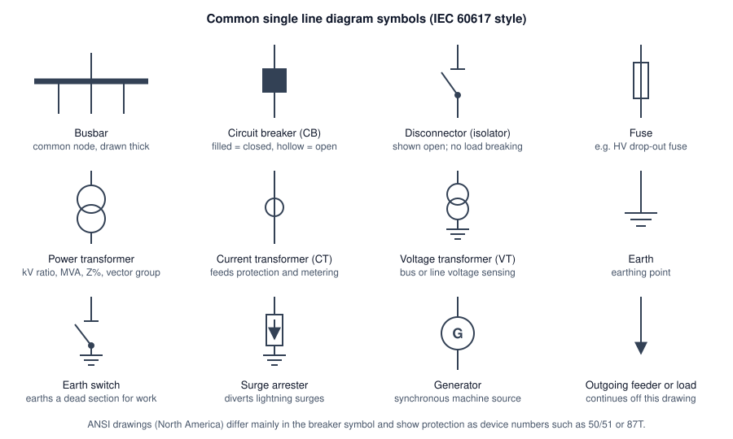
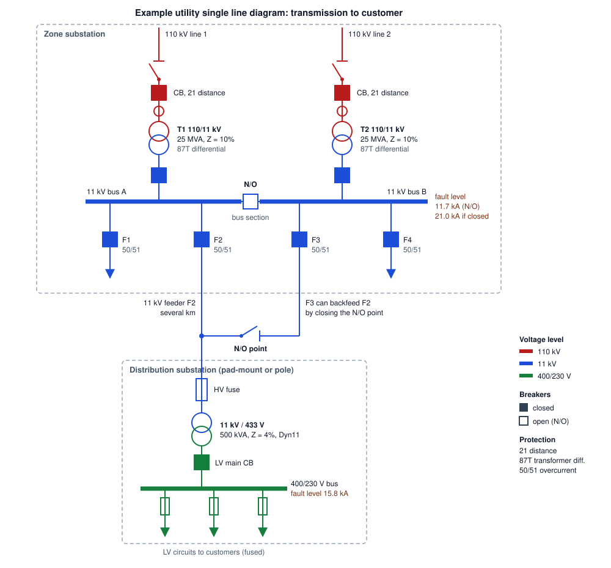

# Utility Single Line Diagrams

How to read a utility single line diagram (SLD): what one line stands for, the symbols, the ratings and protection labels, bus arrangements and switching state, and a fault level calculation that walks down the diagram.

Author

Benedict Thekkel

A single line diagram is the map of an electrical network. It shows what connects to what, at which voltage, through which switches, transformers and protection. Utilities use it to plan, to operate and to keep people safe. A switching operator, a protection engineer and a connection designer all start from the same drawing.

This page builds a typical Australian utility chain, from a 110 kV line down to a 400/230 V customer bus. It explains each part of the drawing. Then it computes the fault level at each bus from the ratings printed on the diagram, and assertions check that the numbers on the drawing match the code.

------------------------------------------------------------------------

## Why one line is enough

A power network carries three phases, so a full wiring diagram needs three conductors for every connection. An SLD draws one. That works because a utility network is designed to be **balanced**. The three phases carry equal currents, 120 degrees apart, so one phase tells you everything about the other two. [Three-Phase Power Systems](three_phase_power_systems.llms.md) covers this per-phase idea in depth.

So one line on an SLD stands for all three phases of a circuit (and the neutral, where there is one). A breaker drawn once is a three-pole breaker. A transformer drawn as two circles is a three-phase transformer.

The single line view stops being enough in three cases:

1.  **Unbalanced faults.** A single phase to earth fault breaks the symmetry. Protection studies then use symmetrical components, and the SLD only supplies the data.
2.  **Secondary wiring.** CT and VT connections, relay inputs and trip circuits need a **three line diagram** or a schematic, which shows each phase.
3.  **Single phase parts of the network.** Rural single wire earth return (SWER) lines and single phase LV services are drawn on the same SLD, but the line no longer means three phases. The drawing labels them.

------------------------------------------------------------------------

## Symbols



Common SLD symbols in IEC 60617 style: busbar, circuit breaker, disconnector, fuse, power transformer, current transformer, voltage transformer, earth, earth switch, surge arrester, generator and outgoing feeder.

The four switching devices are easy to confuse. They differ in what current they can break:

| Device | Breaks load current? | Breaks fault current? | Typical use |
|----|----|----|----|
| Circuit breaker | Yes | Yes | Opened by protection relays. The only device that clears faults on HV feeders and transformers |
| Load break switch | Yes | No | Switching ring main units and feeder sections under load |
| Disconnector (isolator) | No | No | Gives a visible open point for safe work. Operated only after a breaker has opened |
| Fuse | No (on its own) | Yes, once | Cheap fault protection for distribution transformers and LV circuits |

Breaker state matters as much as the symbol. Many utilities draw a closed breaker filled and an open one hollow, and mark a deliberately open device **N/O** (normally open). On a live operating diagram the state is updated as switching happens.

North American drawings follow ANSI/IEEE conventions instead of IEC. The topology reads the same way. The breaker symbol differs, and protection is shown as numbered device circles. The numbers are listed below.

------------------------------------------------------------------------

## Reading a utility SLD



Example utility SLD. Two 110 kV lines feed a zone substation through disconnectors and breakers with distance protection into two 110/11 kV 25 MVA transformers with 10 percent impedance. Each transformer feeds an 11 kV bus; a normally open bus section breaker joins bus A and bus B. Four 11 kV feeders leave through breakers with 50/51 overcurrent protection. Feeder F2 runs several km to a distribution substation: an HV fuse, an 11 kV / 433 V 500 kVA 4 percent Dyn11 transformer, an LV main breaker and a 400/230 V bus with three fused LV circuits. A normally open point between F2 and F3 allows backfeed. Fault levels are 11.7 kA at 11 kV with the bus section open, 21.0 kA with it closed, and 15.8 kA at the LV bus.

Read an SLD in the direction power flows, from source to load. On this drawing that is top to bottom:

1.  **Sources.** Two 110 kV lines come in from the transmission or sub-transmission network. Each passes a disconnector, a breaker and a CT. The breaker carries distance protection (21), which measures impedance to decide whether a fault is on its own line.
2.  **Transformation.** Each line feeds its own 110/11 kV zone transformer. The label gives the ratio, the rating (25 MVA) and the impedance (10%). Differential protection (87T) compares current in and out and trips both sides for an internal fault.
3.  **Busbars.** Each transformer feeds one section of the 11 kV bus. The bus section breaker between them is **normally open**, so each transformer carries its own half of the load. The next section shows why the open tie matters.
4.  **Feeders.** Four 11 kV feeders leave the bus, each through a breaker with overcurrent and earth fault protection (50/51). A feeder runs for kilometres as overhead line or cable.
5.  **Distribution substation.** Along feeder F2, a fuse protects a 500 kVA, 11 kV / 433 V transformer. Its secondary is set about 8% above 400 V, so that voltage at the end of the LV circuits stays within limits under load. An LV main breaker feeds the 400/230 V bus. Fused LV circuits leave the bus for customers.
6.  **Alternate supply.** A normally open point joins the end of F2 to F3. If F2’s breaker trips for a fault near the zone substation, operators isolate the faulted section and close this point. F3 then supplies the rest of F2 from the other side.

The colours follow voltage level, a common habit on utility drawings, so a glance shows where each transformer changes voltage.

------------------------------------------------------------------------

## What the labels tell you

Every number next to a symbol is there because someone downstream needs it.

| Label | Example | Why it matters |
|----|----|----|
| Voltage ratio | 110/11 kV | Sets the voltage on each side, and the base for per-unit calculations |
| Rating | 25 MVA, 500 kVA | Continuous load limit, and the base the impedance is quoted on |
| Impedance | Z = 10% | Limits fault current and sets voltage drop under load. The main input to fault studies |
| Vector group | Dyn11 | Winding connections and phase shift. D = delta HV, y = star LV, n = neutral brought out, 11 = LV leads HV by 30 degrees (11 o’clock). Two transformers can run in parallel only if their groups match |
| Tap range | +/-10% on HV, 17 steps | How far an on-load tap changer can regulate voltage |
| CT ratio | 600/1 A | Scales primary current into the relay. Sets protection and metering accuracy |
| Breaker rating | 1250 A, 25 kA | Continuous current, and the largest fault it can break safely. Must exceed the bus fault level |
| Cable or conductor | 3c 240 mm2 Al XLPE | Rating and impedance of the feeder |
| Fault level | 11.7 kA | Short circuit current at a bus. Sizes switchgear, sets protection and gives the arc flash inputs |

------------------------------------------------------------------------

## Protection device numbers

Protection on an SLD is usually a device number from IEEE C37.2. Australian drawings use the same numbers, even with IEC symbols.

| Number | Function | Where you see it |
|----|----|----|
| 21 | Distance | Transmission and sub-transmission lines |
| 25 | Synchronism check | Breakers that can close two live systems together |
| 27 / 59 | Under / overvoltage | Buses, generator and inverter connections |
| 50 / 51 | Instantaneous / time overcurrent | Feeders, transformer backup |
| 50N / 51N | Earth fault versions of 50 / 51 | Feeders |
| 67 | Directional overcurrent | Parallel feeders, rings, sites with generation |
| 79 | Auto-reclose | Overhead feeders, where most faults are transient |
| 81 | Under / over frequency | Load shedding, generator and inverter connections |
| 86 | Lockout relay | Holds a breaker open after a serious trip until someone resets it |
| 87T / 87B / 87L | Differential: transformer / bus / line | Equipment where fast, selective clearing matters |

------------------------------------------------------------------------

## Bus arrangements

The bus layout decides what one fault or one maintenance outage takes out. It is the first thing to read on a substation SLD.

| Arrangement | How it works | Strength | Weakness |
|----|----|----|----|
| Single bus | Every circuit on one bus | Cheap, simple | A bus fault or bus outage drops everything |
| Sectionalised bus | Bus split by a section breaker, as in the example | A bus fault loses half. Normally open tie limits fault level | Load must be shared across sections by switching |
| Double bus | Each circuit can connect to either of two buses | Maintain one bus while live on the other | More disconnectors and more complex switching |
| Ring bus | Breakers form a closed ring, circuits between them | Any breaker can be maintained without an outage | Hard to extend. Protection is more complex |
| Breaker-and-a-half | Three breakers serve two circuits between two buses | Very high reliability. Common at transmission level | Most expensive |

------------------------------------------------------------------------

## Switching state and normally open points

An SLD shows two different things. The **design** is what is built. The **state** is which devices are open or closed right now. Utility control rooms keep an operating diagram with live state, and every switching program is written against it.

Normally open points are the key to reading a distribution network. Most urban 11 kV networks are built as meshes or rings, but they are **run radially**: one source per section, with an open point somewhere in each loop. A radial run keeps protection simple, because fault current flows only one way. It also keeps fault levels down. When a section fails, operators move the open point to restore supply from another feeder.

For safe work, the SLD is where isolation is planned. The usual sequence is:

1.  Open the breaker to interrupt current.
2.  Open the disconnectors on both sides to make a visible break.
3.  Lock and tag the open devices.
4.  Test that the section is dead.
5.  Close earth switches, or apply portable earths, on both sides.

A missing backfeed path on the drawing is how people get hurt. Embedded generation such as rooftop solar and batteries adds paths that older drawings never showed.

------------------------------------------------------------------------

## Worked example: fault level down the SLD

The ratings on the diagram are enough to compute the three-phase fault current at every bus. The method is **per-unit**. Each impedance is expressed as a fraction of a common base power, $S_{base}$, so impedances on both sides of a transformer can be added directly without referring them through the turns ratio.

Three steps do the work. Convert each element to per-unit on the common base:

$$Z_{pu} = \frac{Z\%}{100} \cdot \frac{S_{base}}{S_{rated}}$$

Add the per-unit impedances in series from the source to the faulted bus. Then convert the total back to fault power and current:

$$S_{fault} = \frac{S_{base}}{Z_{total}} \qquad I_{fault} = \frac{S_{fault}}{\sqrt{3}\, V_{LL}}$$

The upstream grid is given by its fault level at 110 kV, here 2000 MVA, which converts to an impedance the same way. Resistance, feeder impedance and motor contribution are ignored. That gives slightly high, so conservative, currents, which is the safe direction for sizing switchgear.

------------------------------------------------------------------------

``` python
import math

S_BASE_MVA = 100.0

def source_z(fault_mva, s_base=S_BASE_MVA):
    "Per-unit impedance of the upstream grid, from its fault level."
    return s_base / fault_mva

def transformer_z(z_pct, rating_mva, s_base=S_BASE_MVA):
    "Transformer impedance moved from its own rating onto the common base."
    return z_pct / 100 * s_base / rating_mva

def fault_level(z_pu, kv, s_base=S_BASE_MVA):
    "Three-phase fault MVA and kA at a bus whose total source impedance is z_pu."
    mva = s_base / z_pu
    return mva, mva / (math.sqrt(3) * kv)
```

``` python
from IPython.display import Markdown

z_grid = source_z(2000)       # 110 kV grid fault level
z_zone = transformer_z(10, 25)  # each 110/11 kV zone transformer
z_dist = transformer_z(4, 0.5)  # 11 kV / 433 V distribution transformer

buses = {
    "110 kV bus": (z_grid, 110),
    "11 kV bus, section N/O": (z_grid + z_zone, 11),
    "11 kV bus, section closed": (z_grid + z_zone / 2, 11),
    "400 V bus": (z_grid + z_zone + z_dist, 0.433),
    "400 V bus, infinite grid": (z_dist, 0.433),
}

results = {name: (z, *fault_level(z, kv)) for name, (z, kv) in buses.items()}

rows = ["| Bus | Z total (pu) | Fault MVA | Fault kA |", "|---|---:|---:|---:|"]
rows += [f"| {n} | {z:.3f} | {mva:.1f} | {ka:.2f} |" for n, (z, mva, ka) in results.items()]
Markdown("\n".join(rows))
```

| Bus                       | Z total (pu) | Fault MVA | Fault kA |
|---------------------------|-------------:|----------:|---------:|
| 110 kV bus                |        0.050 |    2000.0 |    10.50 |
| 11 kV bus, section N/O    |        0.450 |     222.2 |    11.66 |
| 11 kV bus, section closed |        0.250 |     400.0 |    20.99 |
| 400 V bus                 |        8.450 |      11.8 |    15.78 |
| 400 V bus, infinite grid  |        8.000 |      12.5 |    16.67 |

Three things come out of the table.

1.  **Closing the bus section nearly doubles the 11 kV fault level**, from 11.7 kA to 21.0 kA, because the two transformers then feed a fault in parallel. That is why the tie runs normally open. Closing it would also push all switchgear on both buses closer to its 25 kA breaking rating. The tie is closed only briefly, during load transfers, after checking the result against the rating.
2.  **The LV fault level depends almost entirely on the distribution transformer.** Its 8 pu dwarfs the 0.45 pu upstream. Even an infinitely strong grid would only raise the 400 V fault current from 15.8 kA to 16.7 kA. So LV switchboard ratings can be set from the transformer nameplate alone, which is why connection rules quote prospective fault current by transformer size.
3.  **The same walk works on any SLD.** An SLD is a graph whose edges carry impedances. A fault study adds the impedances along the path from each source to the faulted bus, and combines parallel paths. Commercial tools such as PowerFactory or ETAP do exactly this on networks with thousands of buses, and handle the unbalanced cases with symmetrical components.

------------------------------------------------------------------------

## SLD versus other drawings

An SLD is one drawing in a set. Each answers a different question.

| Drawing | Shows | Used for |
|----|----|----|
| Single line diagram | Topology, ratings, protection, switching state | Planning, operation, fault and load flow studies |
| Three line diagram | Each phase, CT and VT connections | Protection and metering wiring |
| Schematic (protection and control) | Relay logic, trip and close circuits, interlocks | Commissioning and fault finding |
| General arrangement | Physical layout and clearances | Construction and access |
| Cable schedule | Every cable, its route, size and terminations | Installation and maintenance |

------------------------------------------------------------------------

## Australian practice

- **Voltages.** Transmission runs at 275 or 330 kV, and up to 500 kV in the southern states. Sub-transmission runs at 132, 110, 66 or 33 kV. Distribution is mostly 11 kV, with 22 kV in some states and SWER lines in rural areas. Low voltage is 400/230 V under AS 60038.
- **Symbols.** Drawings use IEC 60617 style symbols. Older drawings may use the earlier AS 1102 series.
- **Who owns which SLD.** Each distribution network service provider (DNSP), such as Energex or Ergon Energy in Queensland, keeps its own drafting standards and the operating diagram for its network. Customer installations behind the connection point are the customer’s drawing.
- **When you will be asked for one.** HV customer connections and embedded generation connections (solar, batteries, generators) normally need an SLD with the connection application. The DNSP checks protection, export limits and fault level contribution against it. Inverter systems are installed to AS/NZS 4777.1, and a clear SLD is part of the standard handover documentation.

------------------------------------------------------------------------

## Checklist for reading any SLD

1.  Find the sources: grid supply, generators and inverters.
2.  Follow power from each source to the loads.
3.  Note each voltage level and where transformers change it.
4.  Note every open device, and every normally open point.
5.  Identify the bus arrangement, and what one fault takes out.
6.  Read the protection numbers on each breaker.
7.  Check the fault level at each bus against the switchgear rating.
8.  Look for backfeed paths, especially from embedded generation.

------------------------------------------------------------------------

## Not covered here

- **Protection grading.** How time-current curves on 50/51 relays and fuses are coordinated so that the device nearest the fault trips first.
- **Unbalanced faults.** Symmetrical components, and single phase to earth fault currents, which depend on transformer vector group and earthing.
- **X/R ratio and peak current.** The asymmetric first-cycle current that switchgear must withstand, which the simple calculation above ignores.
- **Earthing systems.** MEN (multiple earthed neutral) in Australian LV installations, and step and touch voltage at substations.
- **Arc flash.** Incident energy studies, which start from the bus fault levels computed here.

------------------------------------------------------------------------

Back to top
