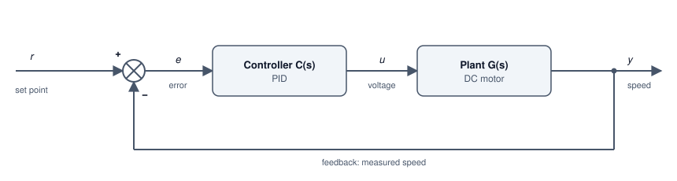

# Control Systems

Transfer functions, poles, step responses, Bode plots and PID control, taking a DC motor from a physics model to a discrete PID loop with anti-windup.

Author

Benedict Thekkel

A control system makes a physical thing follow a command: a motor holds its speed, an oven holds its temperature, a drone holds its height. This page takes one plant, a small DC motor, from a physics model to a tuned PID (proportional, integral, derivative) controller running in discrete time. The tools along the way are transfer functions, poles, step responses and Bode plots.

The analysis uses `scipy.signal`. Every design claim is checked by assertions against a simulation.

## Why feedback



Feedback loop: the set point r and the measured speed y meet at a summing junction to form the error e; the PID controller C(s) turns the error into a voltage u; the plant G(s), a DC motor, turns voltage into speed y, which is measured and fed back.

An **open-loop** controller computes the voltage once, from a model, and hopes. It fails as soon as the model is wrong or something pushes on the motor: a heavier load, a cold bearing, a sagging supply. A **closed-loop** controller measures the output, compares it with the set point, and acts on the error. Feedback buys two things: it rejects disturbances, and it makes the result insensitive to errors in the model.

The price is that feedback can make a stable plant unstable. A controller that reacts too hard, or too late, overshoots, over-corrects, and oscillates. Most of control engineering is about getting the benefit without paying that price.

------------------------------------------------------------------------

## Transfer functions

The motor has a mechanical side and an electrical side. Torque is proportional to current, $\tau = K i$. The spinning armature generates a back-EMF (electromotive force) proportional to speed, $e = K\omega$:

$$J\dot\omega + b\,\omega = K i \qquad L\,\dot i + R\,i = V - K\omega$$

Here $J$ is rotor inertia, $b$ viscous friction, $L$ and $R$ the winding inductance and resistance, and $K$ the motor constant. The **Laplace transform** turns each derivative into a multiplication by $s$, so the differential equations become algebra. Eliminating $i$ gives the **transfer function** from voltage to speed:

$$G(s) = \frac{\Omega(s)}{V(s)} = \frac{K}{(Js + b)(Ls + R) + K^2}$$

A transfer function is the whole input-output behaviour of a linear system in one ratio of polynomials. The roots of the denominator, the **poles**, set how the system moves on its own.

``` python
import numpy as np
from pyecharts import options as opts
from pyecharts.charts import Line, Bar
from pyecharts.globals import CurrentConfig

# assets.pyecharts.org served an expired TLS cert on 2026-11-11; pin the jsDelivr mirror
CurrentConfig.ONLINE_HOST = "https://cdn.jsdelivr.net/gh/pyecharts/pyecharts-assets@f2328d558550046fc5449672a6850e848e141590/assets/v6/"
from scipy import signal

J, b, K, R, L = 0.01, 0.1, 0.01, 1.0, 0.5    # kg m^2, N m s, N m/A, ohm, H
num = np.array([K])
den = np.polyadd(np.polymul([J, b], [L, R]), [K**2])
G = signal.TransferFunction(num, den)
poles = np.roots(den)
dc_gain = num[0] / den[-1]
print("G(s) =", np.round(num, 4), "/", np.round(den, 4))
print("poles:", np.round(poles, 4), "  DC gain:", round(dc_gain, 4), "(rad/s) per V")

t = np.linspace(0, 4, 201)
_, y_open = signal.step(G, T=t)
step_chart = (
    Line(init_opts=opts.InitOpts(width="100%", height="320px"))
    .add_xaxis([f"{x:.2f}" for x in t])
    .add_yaxis("speed for a 1 V step", [round(float(v), 5) for v in y_open], is_symbol_show=False)
    .set_series_opts(label_opts=opts.LabelOpts(is_show=False))
    .set_global_opts(
        title_opts=opts.TitleOpts(title="Open loop: motor speed after a 1 V step"),
        xaxis_opts=opts.AxisOpts(name="s", boundary_gap=False),
        yaxis_opts=opts.AxisOpts(name="rad/s"),
        tooltip_opts=opts.TooltipOpts(trigger="axis"),
    )
)
step_chart.render_notebook()
```

    G(s) = [0.01] / [0.005  0.06   0.1001]
    poles: [-9.9975 -2.0025]   DC gain: 0.0999 (rad/s) per V

The poles sit at about $-2$ and $-10$ per second. Both are real and negative, so the motor is stable and does not oscillate on its own. The pole at $-2$ is slow, with a time constant of 0.5 s. It is the mechanical lag of spinning up the rotor, and it dominates the response. The pole at $-10$ is the electrical lag of the winding. One volt gives only 0.1 rad/s and takes about 2 s to get there. A controller must do much better than that.

------------------------------------------------------------------------

## Poles and stability

Each pole $p$ contributes a term $e^{pt}$ to the response. That one fact gives the whole stability picture:

| Pole location | Term $e^{pt}$ | Behaviour |
|----|----|----|
| Negative real | Decaying exponential | Stable, no overshoot |
| Complex pair, negative real part | Decaying oscillation | Stable, overshoot and ringing |
| On the imaginary axis | Constant oscillation | On the edge of stability |
| Positive real part | Growing | Unstable |

A second-order system with poles $s^2 + 2\zeta\omega_n s + \omega_n^2 = 0$ is described by its **natural frequency** $\omega_n$, which sets the speed, and its **damping ratio** $\zeta$, which sets the overshoot. At $\zeta = 1$ it is critically damped. Below 1 it overshoots, by about 5 % at $\zeta = 0.7$ and 16 % at $\zeta = 0.5$.

Feedback moves the poles. With controller $C(s)$, the loop transfer function is $L(s) = C(s)G(s)$, and the closed loop from set point to output is:

$$T(s) = \frac{L(s)}{1 + L(s)}$$

The closed-loop poles are the roots of $1 + L(s) = 0$. Designing a controller means choosing $C(s)$ to put those roots where you want them.

------------------------------------------------------------------------

## PID control

A PID controller adds three reactions to the error $e(t)$:

$$u(t) = K_p\,e(t) + K_i\int_0^t e\,d\tau + K_d\,\frac{de}{dt} \qquad C(s) = K_p + \frac{K_i}{s} + K_d\,s$$

- **P** pushes in proportion to the error now. On its own, it always leaves a **steady-state error**, because it needs a nonzero error to produce any output at all.
- **I** pushes in proportion to the error accumulated so far. It keeps growing until the error is exactly zero, which removes the steady-state error. Too much makes the loop oscillate.
- **D** pushes against the rate of change of the error. It anticipates, adding damping. It also amplifies measurement noise, so real controllers filter it.

The cell compares three designs on the motor:

1.  **P only**, $K_p = 100$.
2.  **PI** with its zero placed on the slow pole: $K_i/K_p = 2$. The integrator’s zero cancels the motor’s mechanical lag. That leaves $L(s) = 60/(s(s+10))$, a well-damped second-order loop.
3.  **PID** with both zeros placed on both poles: $C(s) = K_d (s - p_1)(s - p_2)/s$. Then $L(s) = K_d K/(JL)\,/\,s = 2K_d/s$, a pure integrator, and the closed loop is first order with time constant $1/(2K_d)$. With $K_d = 5$ that is 0.1 s.

``` python
def closed_loop(c_num, c_den):
    "Closed loop T = CG / (1 + CG) as a TransferFunction."
    l_num, l_den = np.polymul(c_num, num), np.polymul(c_den, den)
    return signal.TransferFunction(l_num, np.polyadd(l_den, l_num))

a1, a0 = den[1] / den[0], den[2] / den[0]    # den / J L = s^2 + a1 s + a0
Kd = 5.0
designs = {
    "P   (Kp=100)":            ([100.0], [1.0]),
    "PI  (Kp=30, Ki=60)":      ([30.0, 60.0], [1.0, 0.0]),
    f"PID (Kp={Kd * a1:.0f}, Ki={Kd * a0:.0f}, Kd={Kd:.0f})": ([Kd, Kd * a1, Kd * a0], [1.0, 0.0]),
}
t = np.linspace(0, 1.5, 151)
results = {}
for name, (cn, cd) in designs.items():
    T = closed_loop(cn, cd)
    _, y = signal.step(T, T=t)
    final = T.num[-1] / T.den[-1]
    overshoot = max(0.0, 100 * (y.max() - final) / final)
    t_settle = t[np.where(np.abs(y - final) > 0.02 * final)[0][-1] + 1]
    results[name] = dict(y=y, poles=np.roots(T.den), final=final)
    print(f"{name:26s} final {final:.3f}  steady-state error {100 * (1 - final):5.1f} %  "
          f"overshoot {overshoot:4.1f} %  2 % settling {t_settle:.2f} s")

cmp_chart = Line(init_opts=opts.InitOpts(width="100%", height="340px")).add_xaxis([f"{x:.2f}" for x in t])
for name, r in results.items():
    cmp_chart.add_yaxis(name.split("(")[0].strip(), [round(float(v), 4) for v in r["y"]], is_symbol_show=False)
cmp_chart = cmp_chart.set_series_opts(label_opts=opts.LabelOpts(is_show=False)).set_global_opts(
    title_opts=opts.TitleOpts(title="Closed loop: speed after a 1 rad/s set-point step"),
    xaxis_opts=opts.AxisOpts(name="s", boundary_gap=False),
    yaxis_opts=opts.AxisOpts(name="rad/s"),
    tooltip_opts=opts.TooltipOpts(trigger="axis"),
    legend_opts=opts.LegendOpts(pos_top="8%"),
)
cmp_chart.render_notebook()
```

    P   (Kp=100)               final 0.909  steady-state error   9.1 %  overshoot 24.9 %  2 % settling 0.57 s
    PI  (Kp=30, Ki=60)         final 1.000  steady-state error   0.0 %  overshoot  7.0 %  2 % settling 0.78 s
    PID (Kp=60, Ki=100, Kd=5)  final 1.000  steady-state error   0.0 %  overshoot  0.0 %  2 % settling 0.40 s

P alone settles 9 % short of the set point and rings on the way. Raising $K_p$ shrinks the error but makes the ringing worse. PI removes the error, with a modest overshoot. The cancellation PID gives a clean first-order rise with a 0.1 s time constant, exactly as designed.

Cancellation is a teaching design, not a robust one. It relies on knowing the poles exactly. If the motor’s real inertia is 20 % higher, the cancellation is imperfect, and a slow tail appears in the response. In practice, engineers tune against margins, which the next section covers. When no model exists at all, the classic **Ziegler-Nichols** experiment finds one by test: raise $K_p$ alone until the loop oscillates steadily at gain $K_u$ with period $T_u$, then set $K_p = 0.6K_u$, $T_i = T_u/2$ and $T_d = T_u/8$. The result is aggressive, and it is usually a starting point for hand tuning.

------------------------------------------------------------------------

## Bode plots and stability margins

A **Bode plot** shows how a system responds to sine waves of each frequency: gain in decibels ($20\log_{10}|L|$) and phase shift, both against log frequency. Applied to the loop $L(s) = C(s)G(s)$, it shows how close the closed loop is to instability, without solving for any poles.

The loop goes unstable if a signal can travel round it and come back the same size and inverted, which is a gain of 1 (0 dB) with a phase of $-180$ degrees. The two **margins** measure the distance from that point:

- **Phase margin**: at the frequency where $|L| = 1$ (the **crossover frequency**), how far the phase is above $-180$ degrees. Aim for 45 to 60 degrees or more.
- **Gain margin**: at the frequency where the phase reaches $-180$ degrees, how far the gain is below 0 dB. Aim for 6 dB or more.

A real derivative term is always filtered. Here $K_d s$ becomes $K_d s / (T_f s + 1)$ with $T_f = 0.01$ s. The filter costs a little phase near crossover, and the margins below include that cost.

``` python
Kp, Ki, Tf = Kd * a1, Kd * a0, 0.01
c_num = np.polyadd(np.polymul([Kp, Ki], [Tf, 1.0]), [Kd, 0.0, 0.0])   # (Kp s + Ki)(Tf s + 1) + Kd s^2
c_den = np.polymul([1.0, 0.0], [Tf, 1.0])                            # s (Tf s + 1)
Lsys = signal.TransferFunction(np.polymul(c_num, num), np.polymul(c_den, den))

w = np.logspace(-1, 3, 161)
_, mag, phase = signal.bode(Lsys, w)
_, mag_g, _ = signal.bode(G, w)
i_c = np.argmin(np.abs(mag))
w_c, pm = w[i_c], 180 + phase[i_c]
gm = "infinite (phase never reaches -180 deg)" if phase.min() > -180 else f"{-np.interp(-180, phase[::-1], mag[::-1]):.1f} dB"
print(f"crossover {w_c:.2f} rad/s, phase margin {pm:.1f} deg, gain margin {gm}")

bode = (
    Line(init_opts=opts.InitOpts(width="100%", height="360px"))
    .add_xaxis([f"{x:.3g}" for x in w])
    .add_yaxis("|L| loop gain (dB)", [round(float(v), 2) for v in mag], is_symbol_show=False)
    .add_yaxis("|G| motor alone (dB)", [round(float(v), 2) for v in mag_g], is_symbol_show=False)
    .add_yaxis("loop phase (deg)", [round(float(v), 2) for v in phase], is_symbol_show=False, yaxis_index=1,
               linestyle_opts=opts.LineStyleOpts(type_="dashed"))
    .extend_axis(yaxis=opts.AxisOpts(name="phase (deg)", min_=-180, max_=0, interval=45))
    .set_series_opts(label_opts=opts.LabelOpts(is_show=False))
    .set_global_opts(
        title_opts=opts.TitleOpts(title="Bode plot of the PID loop"),
        xaxis_opts=opts.AxisOpts(name="rad/s (log)", boundary_gap=False),
        yaxis_opts=opts.AxisOpts(name="gain (dB)"),
        tooltip_opts=opts.TooltipOpts(trigger="axis"),
        legend_opts=opts.LegendOpts(pos_top="8%"),
    )
)
bode.render_notebook()
```

    crossover 10.59 rad/s, phase margin 87.3 deg, gain margin infinite (phase never reaches -180 deg)

The loop gain falls at a steady 20 dB per decade and crosses 0 dB near 10 rad/s, the bandwidth the design asked for. The phase sits near $-90$ degrees and only starts to sag at high frequency, where the derivative filter acts. A phase margin above 80 degrees and an infinite gain margin make this a very safe loop. The price is speed: the design asked for a 0.1 s time constant and nothing faster. Comparing $|L|$ with $|G|$ shows what the controller did. It added gain at low frequency, where the motor was too weak, and none at high frequency, where noise lives.

------------------------------------------------------------------------

## Discrete PID with anti-windup

Real controllers run on a microcontroller, sampling the speed every $\Delta t$ and updating the voltage once per sample. The continuous design carries over directly if $\Delta t$ is much faster than the loop. Here the loop runs at 1 kHz against a 10 rad/s bandwidth. The integral becomes a running sum, and the filtered derivative becomes a one-line recursive update.

Real actuators also have limits. This motor driver cannot apply more than 12 V. While the output is pinned at the limit, the error stays large, and the integral keeps growing. That stored-up integral then has to be unwound by overshooting the other way. This is **integrator windup**. The simplest fix is **conditional integration**: stop integrating while the output is saturated and the error would push it further into saturation.

The cell runs three cases with a 1 rad/s step, which needs 10 V in steady state:

1.  No limit, to confirm the discrete loop matches the continuous design.
2.  A 12 V limit, with a naive integrator.
3.  A 12 V limit, with conditional integration.

``` python
dt, t_end = 1e-3, 6.0
Ad, Bd, Cd, Dd, _ = signal.cont2discrete(signal.tf2ss(num, den), dt, method="zoh")

def run_pid(u_max=np.inf, anti_windup=False, r=1.0):
    "Discrete PID (filtered derivative) driving the ZOH-discretised motor."
    x = np.zeros((Ad.shape[0], 1))
    integ = d = e_prev = 0.0
    ys, us = [], []
    for _ in range(int(round(t_end / dt))):
        y = float((Cd @ x)[0, 0])
        e = r - y
        d = (Tf * d + Kd * (e - e_prev)) / (Tf + dt)      # backward-Euler filtered derivative
        u_raw = Kp * e + integ + d
        u = float(np.clip(u_raw, -u_max, u_max))
        saturated = u != u_raw
        if not (anti_windup and saturated and np.sign(e) == np.sign(u_raw)):
            integ += Ki * e * dt
        x = Ad @ x + Bd * u
        e_prev = e
        ys.append(y); us.append(u)
    return np.array(ys), np.array(us)

tk = np.arange(int(round(t_end / dt))) * dt
y_free, _ = run_pid()
y_wind, u_wind = run_pid(u_max=12.0)
y_aw, u_aw = run_pid(u_max=12.0, anti_windup=True)

T_cont = signal.TransferFunction(np.polymul(c_num, num), np.polyadd(np.polymul(c_den, den), np.polymul(c_num, num)))
_, y_cont = signal.step(T_cont, T=tk)
print(f"no limit: discrete vs continuous, worst difference {np.abs(y_free - y_cont).max():.4f} rad/s")
for name, y in [("12 V limit, naive integrator", y_wind), ("12 V limit, anti-windup", y_aw)]:
    print(f"{name:30s} peak {y.max():.3f} rad/s, overshoot {max(0.0, 100 * (y.max() - 1)):5.1f} %")

idx = np.arange(0, len(tk), 30)
sat_chart = (
    Line(init_opts=opts.InitOpts(width="100%", height="340px"))
    .add_xaxis([f"{x:.3f}" for x in tk[idx]])
    .add_yaxis("no limit", [round(float(v), 4) for v in y_free[idx]], is_symbol_show=False)
    .add_yaxis("12 V, naive integrator", [round(float(v), 4) for v in y_wind[idx]], is_symbol_show=False)
    .add_yaxis("12 V, anti-windup", [round(float(v), 4) for v in y_aw[idx]], is_symbol_show=False)
    .set_series_opts(label_opts=opts.LabelOpts(is_show=False))
    .set_global_opts(
        title_opts=opts.TitleOpts(title="Discrete PID at 1 kHz, with and without a 12 V limit"),
        xaxis_opts=opts.AxisOpts(name="s", boundary_gap=False),
        yaxis_opts=opts.AxisOpts(name="rad/s"),
        tooltip_opts=opts.TooltipOpts(trigger="axis"),
        legend_opts=opts.LegendOpts(pos_top="8%"),
    )
)
sat_chart.render_notebook()
```

    no limit: discrete vs continuous, worst difference 0.0032 rad/s
    12 V limit, naive integrator   peak 1.187 rad/s, overshoot  18.7 %
    12 V limit, anti-windup        peak 1.000 rad/s, overshoot   0.0 %

Without a limit, the 1 kHz loop tracks the continuous design to within a fraction of a percent. With the 12 V limit, the motor can only accelerate so fast, so both limited runs rise slowly. The naive integrator charges up during that long climb, then drives the speed almost 19 % past the set point and takes seconds to unwind. Conditional integration stops the charging, so the speed never overshoots. It pays for that with a slower final approach from below, because the integral only starts building once the output leaves the limit. A refinement called **back-calculation** bleeds the integral towards the value the limit allows, instead of freezing it, and recovers some of that time. Every serious PID implementation, from a drone flight controller to an industrial drive, includes some form of anti-windup for this reason.

------------------------------------------------------------------------

## Summary

| Tool | What it tells you |
|----|----|
| Transfer function $G(s)$ | The whole linear input-output behaviour as a ratio of polynomials |
| Poles | Speed, damping and stability: left half-plane is stable |
| Step response | Rise time, overshoot, settling time and steady-state error |
| Bode plot of $L = CG$ | Bandwidth, and the gain and phase margins against instability |

| Term | Fixes                 | Costs                                         |
|------|-----------------------|-----------------------------------------------|
| P    | Speed of response     | Leaves a steady-state error; too much rings   |
| I    | Steady-state error    | Overshoot, windup when the actuator saturates |
| D    | Damping, anticipation | Noise amplification; needs a filter           |

------------------------------------------------------------------------

Back to top
