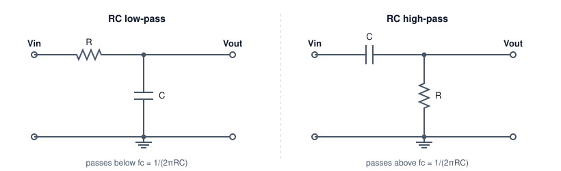

# Filter Design

RC filters, filter order and families, sampling and aliasing, and FIR against IIR digital filters, designed to pull a 5 Hz signal out of 50 Hz hum and noise.

Author

Benedict Thekkel

A filter keeps the frequencies you want and rejects the rest. This page designs filters for one concrete job: a sensor produces a slow 5 Hz signal, sampled at 1 kHz, and mains wiring couples 50 Hz hum and broadband noise into it. The design target is at least **40 dB of rejection at 50 Hz**, with less than **0.5 dB of loss at 5 Hz**.

The page starts with a single resistor and capacitor, shows why that is not enough, then moves through filter order and the standard families, sampling and aliasing, and finally digital FIR and IIR filters applied to a real signal. It complements [FFT Examples](fft_examples.llms.md), which uses Fourier terms to forecast but never designs a filter.

## RC filters: the first-order building block



RC low-pass: a series resistor R from Vin to the output node and a capacitor C from that node to ground, so it passes frequencies below fc = 1/(2 pi R C). RC high-pass: the same two parts swapped, with a series capacitor and a resistor to ground, so it passes frequencies above fc.

A capacitor’s impedance $1/(j\omega C)$ falls as frequency rises. In the low-pass circuit, it forms a voltage divider with $R$ that shorts high frequencies to ground:

$$H(j\omega) = \frac{V_{out}}{V_{in}} = \frac{1}{1 + j\omega RC} \qquad f_c = \frac{1}{2\pi RC}$$

At the **cutoff frequency** $f_c$, the output is $1/\sqrt{2}$ of the input, which is $-3$ dB, and the phase lags 45 degrees. Above $f_c$, the gain falls at 20 dB per decade, a factor of 10 for every factor of 10 in frequency. The high-pass version swaps the parts and mirrors the response.

------------------------------------------------------------------------

Try a 10 k$\Omega$ resistor and a 1 $\mu$F capacitor, which put $f_c$ at 15.9 Hz, between the signal and the hum:

``` python
import numpy as np
from pyecharts import options as opts
from pyecharts.charts import Line, Bar
from pyecharts.globals import CurrentConfig

# assets.pyecharts.org served an expired TLS cert on 2026-11-11; pin the jsDelivr mirror
CurrentConfig.ONLINE_HOST = "https://cdn.jsdelivr.net/gh/pyecharts/pyecharts-assets@f2328d558550046fc5449672a6850e848e141590/assets/v6/"
from scipy import signal

fs = 1000.0                       # Hz, sample rate
f_sig, f_hum = 5.0, 50.0          # Hz
R, C = 10e3, 1e-6
fc_rc = 1 / (2 * np.pi * R * C)

def db(h):
    return 20 * np.log10(np.abs(h))

def rc_lowpass(f):
    return 1 / (1 + 1j * 2 * np.pi * f * R * C)

print(f"fc = {fc_rc:.1f} Hz")
print(f"at  5 Hz: {db(rc_lowpass(f_sig)):6.2f} dB   (target: better than -0.5 dB)")
print(f"at 50 Hz: {db(rc_lowpass(f_hum)):6.2f} dB   (target: -40 dB or lower)")
```

    fc = 15.9 Hz
    at  5 Hz:  -0.41 dB   (target: better than -0.5 dB)
    at 50 Hz: -10.36 dB   (target: -40 dB or lower)

The RC filter fails both targets at once. It removes only 10 dB of hum, and it already costs 0.4 dB of the signal, which is close to the limit. Moving $f_c$ down helps the hum and hurts the signal. A first-order slope of 20 dB per decade is too gentle when the frequencies to keep and to reject are only a factor of 10 apart. The fix is a steeper slope, which means a higher **order**.

------------------------------------------------------------------------

## Order and filter families

An $N$th-order filter has $N$ energy-storing elements (capacitors or inductors), or the digital equivalent. Its slope beyond cutoff is $20N$ dB per decade. For a fixed order, there is still a choice of *shape*, and each classic family optimises one property:

| Family | Optimises | Trade-off |
|----|----|----|
| Butterworth | Flattest possible passband | Moderate roll-off |
| Chebyshev type I | Steeper roll-off | Ripple in the passband |
| Chebyshev type II | Steep roll-off, flat passband | Ripple in the stopband |
| Elliptic (Cauer) | Steepest roll-off for the order | Ripple in both bands |
| Bessel | Constant delay, so no overshoot on steps | Gentlest roll-off |

The chart compares analog Butterworth filters of increasing order with a 4th-order Chebyshev type I that allows 1 dB of passband ripple. All have their cutoff at 20 Hz.

``` python
f = np.logspace(0, np.log10(500), 160)
wa = 2 * np.pi * f
fc = 20.0
curves = {}
for n in (1, 2, 4, 6):
    b, a = signal.butter(n, 2 * np.pi * fc, analog=True)
    curves[f"Butterworth N={n}"] = db(signal.freqs(b, a, wa)[1])
b, a = signal.cheby1(4, 1, 2 * np.pi * fc, analog=True)
curves["Chebyshev I N=4, 1 dB"] = db(signal.freqs(b, a, wa)[1])

for name, g in curves.items():
    print(f"{name:24s} at 5 Hz {np.interp(5, f, g):6.2f} dB   at 50 Hz {np.interp(50, f, g):7.2f} dB")

fam = Line(init_opts=opts.InitOpts(width="100%", height="360px")).add_xaxis([f"{x:.3g}" for x in f])
for name, g in curves.items():
    fam.add_yaxis(name, [round(float(v), 2) for v in g], is_symbol_show=False)
fam = fam.set_series_opts(label_opts=opts.LabelOpts(is_show=False)).set_global_opts(
    title_opts=opts.TitleOpts(title="Analog low-pass filters, cutoff 20 Hz"),
    xaxis_opts=opts.AxisOpts(name="Hz (log)", boundary_gap=False),
    yaxis_opts=opts.AxisOpts(name="gain (dB)", min_=-100, max_=5),
    tooltip_opts=opts.TooltipOpts(trigger="axis"),
    legend_opts=opts.LegendOpts(pos_top="8%"),
)
fam.render_notebook()
```

    Butterworth N=1          at 5 Hz  -0.26 dB   at 50 Hz   -8.60 dB
    Butterworth N=2          at 5 Hz  -0.02 dB   at 50 Hz  -16.03 dB
    Butterworth N=4          at 5 Hz  -0.00 dB   at 50 Hz  -31.84 dB
    Butterworth N=6          at 5 Hz  -0.00 dB   at 50 Hz  -47.75 dB
    Chebyshev I N=4, 1 dB    at 5 Hz  -0.31 dB   at 50 Hz  -42.54 dB

A 4th-order Butterworth reaches only about $-32$ dB at 50 Hz, short of the target. A 6th-order one gets past $-40$ dB and still loses almost nothing at 5 Hz. The Chebyshev beats the 4th-order Butterworth at 50 Hz, paid for with the 1 dB ripple it is allowed in the passband. When no ripple is acceptable, add order instead.

------------------------------------------------------------------------

## Sampling and aliasing

A digital filter only ever sees samples. Sampling at $f_s$ can represent frequencies up to the **Nyquist frequency** $f_s/2$, here 500 Hz. Anything above it does not disappear. It **aliases**: it folds back and appears as a lower frequency that the samples cannot tell apart from a real one.

The cell shows a 950 Hz tone sampled at 1 kHz. Its samples are exactly those of a 50 Hz tone, inverted. Once it is sampled, no digital filter can separate it from real mains hum.

``` python
n = np.arange(40)
tn = n / fs
s950 = np.sin(2 * np.pi * 950 * tn)
s50 = np.sin(2 * np.pi * 50 * tn)
print("950 Hz samples:", np.round(s950[:6], 3))
print(" 50 Hz samples:", np.round(s50[:6], 3))
print(f"largest |s950 + s50| over 40 samples: {np.abs(s950 + s50).max():.1e}")
```

    950 Hz samples: [ 0.    -0.309 -0.588 -0.809 -0.951 -1.   ]
     50 Hz samples: [0.    0.309 0.588 0.809 0.951 1.   ]
    largest |s950 + s50| over 40 samples: 1.9e-14

This is why every analog-to-digital converter needs an **anti-aliasing filter**: an analog low-pass ahead of the converter that removes everything above $f_s/2$ while it is still separable. Digital filtering can only clean up what survives sampling.

------------------------------------------------------------------------

## Digital filters: FIR and IIR

There are two kinds of digital filter.

A **FIR** (finite impulse response) filter computes each output as a weighted sum of recent inputs: $y[n] = \sum_{k=0}^{M} b_k\,x[n-k]$. It has no feedback, so it is always stable. With symmetric weights, it has **linear phase**: every frequency is delayed by the same $M/2$ samples, so wave shapes are preserved. The cost is length: sharp responses need many taps. The **window method** (`firwin`) truncates the ideal impulse response and tapers it with a window, here Hamming, to control ripple.

An **IIR** (infinite impulse response) filter also feeds back past outputs: $y[n] = \sum b_k x[n-k] - \sum a_k y[n-k]$. It reaches a given sharpness with far fewer coefficients, because it is the digital twin of an analog filter. `butter(..., fs=...)` maps an analog Butterworth into discrete time with the **bilinear transform**. Its phase is not linear, and high-order IIR filters are numerically fragile, so they are run as a cascade of **second-order sections** (SOS).

A third option targets one frequency: a **notch** filter removes a narrow band around 50 Hz and leaves everything else, noise included.

``` python
numtaps = 101
fir = signal.firwin(numtaps, fc, window="hamming", fs=fs)
iir = signal.butter(6, fc, output="sos", fs=fs)
b_n, a_n = signal.iirnotch(f_hum, Q=30, fs=fs)

fd = np.linspace(0.5, 150, 300)
h = {
    "FIR, 101 taps": signal.freqz(fir, worN=fd, fs=fs)[1],
    "IIR Butterworth N=6": signal.sosfreqz(iir, worN=fd, fs=fs)[1],
    "IIR notch at 50 Hz": signal.freqz(b_n, a_n, worN=fd, fs=fs)[1],
}
cost = {"FIR, 101 taps": numtaps, "IIR Butterworth N=6": iir.size - iir.shape[0], "IIR notch at 50 Hz": len(b_n) + len(a_n) - 1}
for name, hh in h.items():
    g = db(hh)
    print(f"{name:20s} at 5 Hz {np.interp(5, fd, g):6.2f} dB   at 50 Hz {np.interp(50, fd, g):7.1f} dB   "
          f"multiplies per sample {cost[name]}")

resp = Line(init_opts=opts.InitOpts(width="100%", height="360px")).add_xaxis([f"{x:.1f}" for x in fd])
for name, hh in h.items():
    resp.add_yaxis(name, [round(float(v), 2) for v in np.maximum(db(hh), -120)], is_symbol_show=False)
resp = resp.set_series_opts(label_opts=opts.LabelOpts(is_show=False)).set_global_opts(
    title_opts=opts.TitleOpts(title="Digital filters at fs = 1 kHz"),
    xaxis_opts=opts.AxisOpts(name="Hz", boundary_gap=False),
    yaxis_opts=opts.AxisOpts(name="gain (dB)", min_=-120, max_=5),
    tooltip_opts=opts.TooltipOpts(trigger="axis"),
    legend_opts=opts.LegendOpts(pos_top="8%"),
)
resp.render_notebook()
```

    FIR, 101 taps        at 5 Hz  -0.11 dB   at 50 Hz   -83.2 dB   multiplies per sample 101
    IIR Butterworth N=6  at 5 Hz  -0.00 dB   at 50 Hz   -48.1 dB   multiplies per sample 15
    IIR notch at 50 Hz   at 5 Hz  -0.00 dB   at 50 Hz  -268.9 dB   multiplies per sample 5

Both low-pass designs meet the target. The FIR needs 101 multiplies per sample. The 6th-order IIR needs 15, in three second-order sections. On a small microcontroller, that difference decides the design. The notch removes the hum with only 5 multiplies, but it passes everything else, so the broadband noise stays.

------------------------------------------------------------------------

## Filtering a signal, and the cost of delay

Now the filters meet a signal. Two seconds of a 5 Hz sine, plus 50 Hz hum at 0.8 of its size, plus white noise, all sampled at 1 kHz. Each filter is scored by the RMS (root mean square) error against the clean sine, ignoring 0.2 s at each end where the filters start up.

A causal filter, one that only uses past samples, must delay its output. For the IIR filter, the delay varies with frequency. The cell measures it at 5 Hz by cross-correlation. **Zero-phase** filtering (`sosfiltfilt`) runs the filter forwards and then backwards, so the two phase shifts cancel. It needs the whole recording, so it only works offline.

``` python
rng = np.random.default_rng(0)
t = np.arange(0, 2.0, 1 / fs)
clean = np.sin(2 * np.pi * f_sig * t)
noisy = clean + 0.8 * np.sin(2 * np.pi * f_hum * t) + 0.3 * rng.standard_normal(t.size)

out = {
    "noisy input": noisy,
    "FIR (delay removed)": np.roll(signal.lfilter(fir, 1.0, noisy), -(numtaps - 1) // 2),
    "IIR causal": signal.sosfilt(iir, noisy),
    "IIR zero-phase": signal.sosfiltfilt(iir, noisy),
}
core = (t > 0.2) & (t < 1.8)

def rms_err(y):
    return np.sqrt(np.mean((y[core] - clean[core]) ** 2))

lags = np.arange(0, 100)
xc = [np.dot(out["IIR causal"][core], np.roll(clean, k)[core]) for k in lags]
delay = lags[int(np.argmax(xc))]
aligned = np.roll(out["IIR causal"], -delay)

for name, y in out.items():
    print(f"{name:22s} RMS error {rms_err(y):.3f}")
print(f"IIR causal delay at 5 Hz: {delay} samples = {delay / fs * 1e3:.0f} ms; "
      f"after removing it the RMS error is {rms_err(aligned):.3f}")

idx = np.where((t >= 0.6) & (t < 1.0))[0][::2]
sig = Line(init_opts=opts.InitOpts(width="100%", height="360px")).add_xaxis([f"{x:.3f}" for x in t[idx]])
sig.add_yaxis("noisy input", [round(float(v), 3) for v in noisy[idx]], is_symbol_show=False,
              linestyle_opts=opts.LineStyleOpts(width=1, opacity=0.5))
sig.add_yaxis("clean 5 Hz", [round(float(v), 3) for v in clean[idx]], is_symbol_show=False,
              linestyle_opts=opts.LineStyleOpts(type_="dashed"))
sig.add_yaxis("IIR causal", [round(float(v), 3) for v in out["IIR causal"][idx]], is_symbol_show=False)
sig.add_yaxis("IIR zero-phase", [round(float(v), 3) for v in out["IIR zero-phase"][idx]], is_symbol_show=False)
sig = sig.set_series_opts(label_opts=opts.LabelOpts(is_show=False)).set_global_opts(
    title_opts=opts.TitleOpts(title="0.4 s of the signal before and after filtering"),
    xaxis_opts=opts.AxisOpts(name="s", boundary_gap=False),
    yaxis_opts=opts.AxisOpts(name="value"),
    tooltip_opts=opts.TooltipOpts(trigger="axis"),
    legend_opts=opts.LegendOpts(pos_top="8%"),
)
sig.render_notebook()
```

    noisy input            RMS error 0.647
    FIR (delay removed)    RMS error 0.056
    IIR causal             RMS error 0.661
    IIR zero-phase         RMS error 0.059
    IIR causal delay at 5 Hz: 31 samples = 31 ms; after removing it the RMS error is 0.061

The zero-phase IIR and the delay-corrected FIR both recover the 5 Hz sine almost exactly. The residual error is the small slice of noise that falls inside the 20 Hz passband, and no low-pass filter can remove that. The causal IIR output is just as clean, but it arrives late. Scored against the clean signal at the same instant, the 31 ms lag makes it score worse than the unfiltered input. With its delay removed, its error matches the others.

The delay is the real price of causal filtering, and sharper filters pay more of it. In a control loop like the one in [Control Systems](control_systems.llms.md), that delay is phase lag, and it eats directly into the phase margin. That is why loop sensors are filtered as lightly as possible, and why heavy filtering belongs in logging and analysis, where zero-phase filtering is free.

------------------------------------------------------------------------

## Summary

|  | FIR | IIR |
|----|----|----|
| Structure | Weighted sum of past inputs | Also feeds back past outputs |
| Stability | Always stable | Must be designed stable; run as SOS |
| Phase | Exactly linear with symmetric taps | Nonlinear; use `sosfiltfilt` offline for zero phase |
| Cost for a sharp filter | Many taps (101 here) | Few coefficients (15 here) |
| Typical use | Audio, communications, anything shape-sensitive | Sensors, control, low-power embedded |

| Check | Rule |
|----|----|
| Slope | $20N$ dB per decade for order $N$ |
| Sampling | Keep content below $f_s/2$; filter before the converter |
| Family | Butterworth for a flat passband; Chebyshev or elliptic for steepness; Bessel to keep shapes |
| Hum | A notch removes it cheaply but leaves broadband noise |

------------------------------------------------------------------------

Back to top
