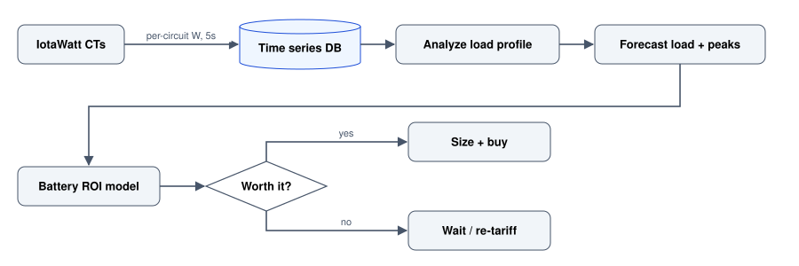

# Sense -\> Analyze -\> Decide: From IotaWatt to a Home-Battery ROI

A full loop of home energy: measure circuits with an IotaWatt, forecast load and peaks, then decide whether a home battery actually pays for itself.

Author

Benedict Thekkel

> Home energy is a rare project where you get the whole data lifecycle in one place: **sense** the real load, **analyze / forecast** it, then **decide** on capital kit like a battery. This ties together:

- Sensing hardware: [IotaWatt](https://bthek1.github.io/Hardware_Tools/Embedded_Systems/iotawatt.html) in [**Hardware_Tools**](https://bthek1.github.io/Hardware_Tools)
- Forecasting: [electricity load](electricity_load_forecasting.llms.md) and [peak](electricity_peak_forecasting.llms.md) on this site
- Decision: the battery payback model below

## The loop

IotaWatt CTs log per-circuit watts every 5 seconds to a time series database, which feeds load profile analysis, a load and peak forecast and a battery ROI model that decides between sizing and buying a battery or waiting and changing tariff.

## Sense: what an IotaWatt gives you

The [IotaWatt](https://bthek1.github.io/Hardware_Tools/Embedded_Systems/iotawatt.html) clamps a CT around each circuit and logs real power every few seconds - no utility meter guesswork. That per-circuit resolution is what makes the later decision honest: you see exactly which loads drive your peaks.

A representative daily load profile - note the morning and evening peaks that a battery would shave:

## Analyze + forecast

With history in hand, the [load](electricity_load_forecasting.llms.md) and [peak](electricity_peak_forecasting.llms.md) forecasting notebooks forecast both average load and - the number that sizes a battery - the *peaks*. Peak forecasting matters because demand tariffs and battery sizing both key off the top of the curve, not the mean. See [peak forecasting](electricity_peak_forecasting.llms.md).

## Decide: does a battery pay for itself?

The battery model turns the measured profile + tariffs into a payback. The ROI is dominated by self-consumption - how much stored solar you actually use instead of exporting cheap and buying back dear.

| Battery | Usable kWh | Installed cost | Annual saving | Payback  |
|---------|------------|----------------|---------------|----------|
| Small   | 5          | \$6,500        | \$520         | ~12.5 yr |
| Medium  | 10         | \$11,000       | \$980         | ~11 yr   |
| Large   | 13.5       | \$14,500       | \$1,180       | ~12 yr   |

*Representative figures; depends heavily on tariff, solar size, and usage.*

## Self-consumption is the whole game

With the medium battery, modelled self-consumption of on-site solar rises from ~40% to ~78% - that delta is the saving.

## Takeaway

Measure before you buy. The [IotaWatt](https://bthek1.github.io/Hardware_Tools/Embedded_Systems/iotawatt.html) turns “a battery feels worth it” into a payback curve you can actually defend - and in my modelling, at current tariffs, the honest answer is often *“wait for prices to fall or a demand tariff to bite.”* The point is that the data, not the vibe, made the call.

------------------------------------------------------------------------

Back to top
